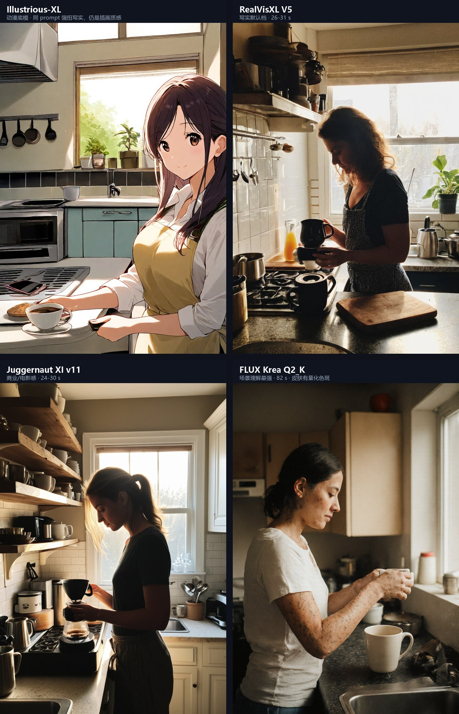
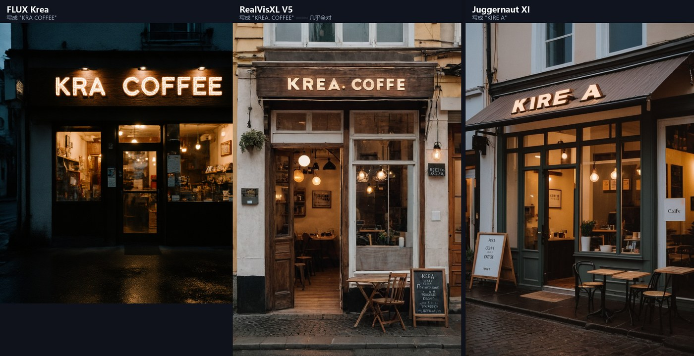
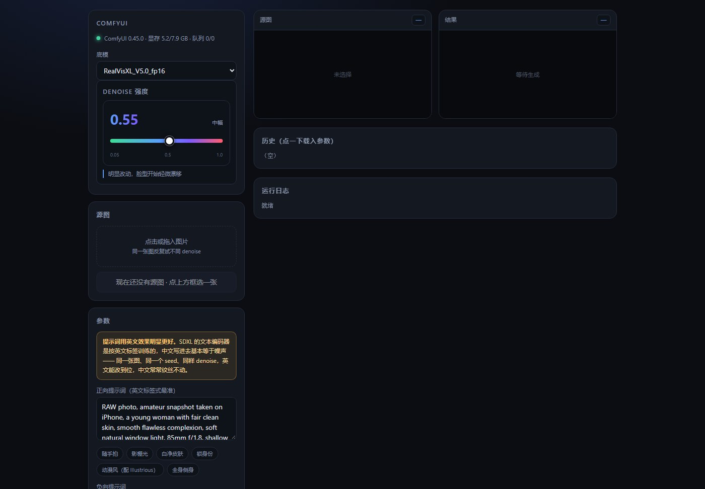

# comfyui-dsh — local image generation, ComfyUI + DeepSeek Harness

[](docs/COMPATIBILITY.md)
[](https://github.com/devin667/comfyui-dsh/releases/tag/v1.2.1)
[](docs/MODELS.md)
[](dsh/workflows)
[](LICENSE)
[](docs/COMPATIBILITY.md)

[中文说明](README.md) · **English** · [Changelog](CHANGELOG.md) · [Compatibility](docs/COMPATIBILITY.md)


---

ComfyUI runs on `127.0.0.1:8188`; the DSH **`dsh-image-gen`** plugin calls it over HTTP.
The whole generation path stays on your machine: no server-side moderation, no
per-image billing, output lands on your own disk. Swap checkpoints freely, drag a
denoise slider, switch models with one sentence.

Measured on an 8 GB RTX 5060 Laptop: SDXL at 832×1216 runs **26–33 s** warm,
HiRes 1.5× in 58 s.

### Four checkpoints, one image to see the difference



Same prompt (`RAW photo, amateur snapshot taken on iPhone, woman in a cluttered
kitchen making coffee, morning backlight, unedited`), same scene:

| Checkpoint | Size | Warm image | Role |
|---|---|---|---|
| **RealVisXL V5.0 fp16** | 6.5 GB | **26–31 s** | Photoreal default. Best documentary / everyday feel |
| Juggernaut XI v11 | 6.6 GB | 24–30 s | Commercial / cinematic, steadier hands, but over-polished |
| Illustrious-XL v1.1 | 6.5 GB | 26–33 s | Anime illustration. Top-left is that model forced with a photo prompt |
| FLUX.1 Krea dev Q2_K | 3.7 GB | 82 s | Best scene comprehension, 3–4× slower, quantization spots on skin |

Six-scene comparison, all four FLUX quantization tiers, four prompt styles and the
parameter sweet spots are in **[docs/MODELS.md](docs/MODELS.md)** (Chinese).

### Clean skin

That string of `freckles, moles, birthmark, blemishes, skin spots, acne, large pores...`
in the default negative prompt is not decoration. Photoreal models produce freckled
faces mostly because the prompt itself contains the word `freckles`.


### In-image text: don't count on it

Same prompt, three checkpoints, three different spellings:



`KRA COFFEE` / `KREA. COFFEE` / `KIRE A`. Add text in post.

### The Denoise slider



`启动Denoise滑杆.bat` → `http://127.0.0.1:8189`. Drop in an image, drag the slider,
compare source and result live. Click a history entry to reload its parameters.

Range 0.05–1.00, `0.55` is the default — conservative edit, identity preserved.
Above 0.75 it starts repainting heavily; 0.97 uses the source for composition only.

**Prompts must be English and tag-style.** Same image, same seed, same denoise:

```
Chinese:  keep this pose, same art style, same girl, change background to a sunny beach
          → background barely moved
English:  same pose, same art style, same girl, identical face,
          identical long silver hair, sunny beach background,
          bright daylight, clear sky                    → worked
```

Write **state tags** (`sunny beach`, `bright daylight`) rather than **motion instructions**
(`change the background to`) — the latter gets a weak response.

---

## Install

Two options, same content:

```powershell
# Option 1: download the release (no git needed)
# Grab comfyui-dsh.zip from Releases, unzip to D:\ComfyUI

# Option 2: git clone
git clone https://github.com/devin667/comfyui-dsh.git D:\ComfyUI

cd D:\ComfyUI
powershell -ExecutionPolicy Bypass -File .\install.ps1
```

`install.ps1` has 9 idempotent steps; if it is interrupted, just run it again.
Steps 7 and 8 are the optional photoreal checkpoints and FLUX:

```powershell
.\install.ps1                                 # anime checkpoint only (15 GB)
.\install.ps1 -WithRealistic                  # + RealVisXL V5 (recommended, 21.5 GB)
.\install.ps1 -WithRealistic -WithJuggernaut  # both photoreal SDXL checkpoints (28 GB)
.\install.ps1 -WithRealistic -WithFlux        # + FLUX four-piece set and GGUF nodes (24 GB)
```

Then double-click `启动ComfyUI.bat` and run `node .\dsh\apply-workflows.mjs` to wire it
into DSH. Step-by-step instructions and troubleshooting: **[docs/INSTALL-QUICK.md](docs/INSTALL-QUICK.md)**.

Want an AI to install it for you? Paste **[docs/AGENT-PROMPT.md](docs/AGENT-PROMPT.md)**
into DSH (or any agent that can run commands) — it walks the whole thing and self-checks.

---

## Speed

Conditions: `832×1216`, SDXL 30 steps / cfg 5 / dpmpp_2m karras, RTX 5060 Laptop 8 GB.

| Checkpoint | Warm image | First image (incl. load) | HiRes 1.5× (1248×1824) |
|---|---|---|---|
| Illustrious-XL | 26–33 s | 150 s | 62 s |
| **RealVisXL V5** | **26–31 s** | 150 s | **58 s** |
| Juggernaut XI v11 | 24–30 s | 150 s | 58 s |
| FLUX Krea Q2_K (24 steps) | 82 s | 240 s | — |

### Launch flags

```bat
main.py --listen 127.0.0.1 --port 8188 --cache-lru 8 --reserve-vram 0.3
```

Those four, nothing else. Why:

| Flag | Reason |
|---|---|
| `--cache-lru 8` | Cache node results. **Required** — the `--cache-none` default recomputes every node every time |
| `--reserve-vram 0.3` | Leave 300 MB for the desktop. 0.5 is too conservative and triggers dynamic VRAM loading; 0 OOMs on FLUX |
| ~~`--fast cublas_ops`~~ | **Don't.** With clean VRAM it is 3.5× slower (115 s vs 32 s) |
| ~~`--fast fp16_accumulation`~~ | **Don't.** 3.5× slower on its own (72–87 s) |
| ~~`--enable-triton-backend`~~ | **Don't.** Catastrophic with triton 3.5.1 installed — FLUX runs 178–295 s per step |
| ~~`--highvram`~~ | Don't. 8 GB cannot hold the 4.9 GB weights without thrashing |

**The single most useful lesson**: when generation gets slow, check `nvidia-smi` for
`memory.free` first. 3.4 GB free versus 6.2 GB free is 142 seconds versus 32 seconds —
bigger than any flag you can change. A browser plus WeChat plus NVIDIA Overlay eats 2 GB.

The full investigation is in **[docs/PERFORMANCE.md](docs/PERFORMANCE.md)** (Chinese).

---

## Wiring into DSH

Requires the `dsh-image-gen` plugin (0.11.x).

```powershell
node .\dsh\apply-workflows.mjs      # writes into the profile config, backs it up first
```

Restart DSH → Settings → Plugins → Image Generation → Provider `comfyui`, Base URL
`http://127.0.0.1:8188`. After that `generate_image` / `edit_image` all stay local.

**One trap**: the `dsh-image-gen` **Studio workbench does not support ComfyUI**.
`CLOUD_IMAGE_PROVIDERS` has no `comfyui` entry, so the workbench falls back to the first
cloud provider that has a key configured. The agent tool path is unaffected — asking the
agent to draw in chat stays local; clicking in the workbench still goes to the cloud.

### Switching checkpoints: the `dsh-comfy-models` plugin

`dsh-image-gen` alone only lets you pick a workflow; changing the model means editing
YAML and restarting. This plugin fills that gap.

```powershell
powershell -ExecutionPolicy Bypass -File .\dsh\install-plugin.ps1
```

| Tool | What it does |
|---|---|
| `comfy_models_list` | List every checkpoint in ComfyUI plus current workflow and active entry |
| `comfy_models_sync` | Auto-generate text2img / edit / HiRes workflows for any new checkpoint |
| `comfy_models_switch` | Switch with one word: `juggernaut` / `flux` / `realvis` all match |

Match priority: exact → case-insensitive exact → prefix → substring, shortest name wins
at the same level (so `juggernaut` hits `Juggernaut-XI`, not `Juggernaut-XI-Edit`).

It edits the profile's `cordis.patch.yml`, which is watched by HMR — **changes take
effect in about fifteen seconds, no DSH restart needed**. Details in
[plugin/README.md](plugin/README.md).

---

## What gets installed

| Item | Location | Notes |
|---|---|---|
| ComfyUI source | `ComfyUI-0.45.0/` | Upstream v0.45.0, unmodified |
| Python runtime | `python-base/` | Standalone 3.12 copy, does not touch system Python |
| Python env | `venv/` | torch 2.9.0+cu130 plus 90 packages |
| SDXL anime checkpoint | `models/checkpoints/` | Illustrious-XL v1.1, 6.5 GB |
| SDXL photoreal checkpoints | `models/checkpoints/` | RealVisXL V5.0 fp16 (default), Juggernaut XI v11 |
| FLUX diffusion model | `models/diffusion_models/` | flux1-krea-dev-Q2_K.gguf, 3.7 GB |
| FLUX text encoders | `models/text_encoders/` | t5-v1_1-xxl-Q4_K_S (2.55 GB) + clip_l (235 MB) |
| FLUX VAE | `models/vae/` | flux_ae.safetensors, 320 MB |
| GGUF loader nodes | `custom_nodes/ComfyUI-GGUF/` | Reads quantized FLUX weights |
| Denoise slider | `slider/` | Zero-dependency Node service on 8189 |
| DSH wiring | `dsh/` | Workflow JSON + patch fragment + apply script |
| Checkpoint switcher | `plugin/` | `dsh-comfy-models`, three tools |
| Helper scripts | `scripts/` | Resumable downloader, benchmark, packaging |

**Not in the repo** (too large — the installer fetches them):

- Model weights ≈ 19 GB — from the HF mirror
- `venv/` 4.3 GB — built locally
- `python-base/` 381 MB — copied from the official portable build
- ComfyUI source — downloaded by tag

Full install is about **33 GB** on disk (15 GB with only one SDXL checkpoint).

---

## Requirements

| Item | Minimum | This machine |
|---|---|---|
| GPU | 6 GB VRAM, CUDA capable | RTX 5060 Laptop, 8 GB |
| RAM | 16 GB | 16 GB |
| Disk | 15 GB free (33 GB with all four) | 552 GB |
| OS | Windows 10/11 x64 | Windows 11 26100 |
| Driver | ≥ 570 (cu130) | 617.42 |

**4 GB VRAM or pure CPU for SDXL is not supported** — it starts, but one image takes
20 minutes or more.

The full matrix of VRAM tiers, CUDA versions, OS, Python and ComfyUI versions and port
conflicts is in **[docs/COMPATIBILITY.md](docs/COMPATIBILITY.md)** (Chinese). Its last
section lists the physical limits no flag can fix: SDXL at 1024×1024 on 4 GB, full
precision FLUX on 8 GB, SDXL on CPU. The path there is more VRAM, 16 GB and up.

---

## Why run locally

Cloud image services moderate server-side and reject the request outright:

```
DashScope image generation failed (400):
{"code":"DataInspectionFailed","message":"Green net check rejected image (output)"}
```

`(input)` is a text-layer block — rewording sometimes gets through. `(output)` means the
**generated image was rejected after generation**; the judgement is on pixels, so no
prompt wording changes it. A local deployment moves the whole pipeline onto your own
machine, and that server-side check simply is not in the path.

Cost comparison: **[docs/why-local.md](docs/why-local.md)** (Chinese).

---

## Safety and uninstall

- **No registry writes**, **no system services**, **no autostart**
- Does not touch the GPU driver, installs no kernel drivers
- When not running: 0 processes, 0 VRAM, 0 CPU
- Uninstall: kill the python process, delete the directory

Ports bind to `127.0.0.1` only — other machines on the LAN cannot reach it.

---

## Starting the server from a script

`serve_comfy.py` spawns the process with `CREATE_BREAKAWAY_FROM_JOB`, leaving the
caller's Job Object:

```powershell
python D:\ComfyUI\serve_comfy.py      # silent, detached from the session
```

`Start-Process` is not enough — an agent shell runs inside a Windows Job, and killing
that job walks the whole process tree. For interactive use, double-click
`启动ComfyUI.bat` (it has a console window showing progress).

It does three things: check whether something already listens on 8188 -> if yes,
just `start` the browser and exit (no more `Port 8188 is already in use`) -> if no,
launch the server and spawn `open_when_ready.bat` in the background, which polls the
port and opens the browser the moment the server answers.

`start.bat` is the same logic duplicated with pure ASCII. Two copies are needed
because a `.bat` that mentions a Chinese filename resolves it to a garbage path
under a non-936 console codepage and dies with
`is not recognized as an internal or external command`. The Chinese-named one is
for double-clicking in Explorer; the ASCII one is for terminals and automation.

---

## Layout

```
ComfyUI-0.45.0/           ComfyUI source (v0.45.0, unmodified)
  models/checkpoints/     Illustrious-XL / RealVisXL-V5.0 / Juggernaut-XI-v11
  models/diffusion_models/ flux1-krea-dev-Q2_K.gguf
  models/text_encoders/   t5-v1_1-xxl-Q4_K_S.gguf + clip_l.safetensors
  models/vae/             flux_ae.safetensors
  custom_nodes/ComfyUI-GGUF/   FLUX GGUF loader nodes
python-base/              standalone Python 3.12 (relocatable)
venv/                     Python environment
slider/                   Denoise slider (server.mjs / index.html / cli.mjs)
dsh/
  workflows/              10 workflow JSON files (4 checkpoints × text2img/edit + 2 HiRes)
  workflows.manifest.json workflow metadata + preset prompts
  apply-workflows.mjs     writes into cordis.patch.yml
  export-from-profile.mjs reverse export from the profile
  install-plugin.ps1      installs the checkpoint switcher
plugin/                   dsh-comfy-models (catalog / index / yaml-store + negative scripts)
scripts/
  fetch_parts.sh          resumable downloader (validates 206 + byte count + magic)
  bench_final.py          benchmark script
  pack-release.ps1        git archive packaging
  make-release.py         create the GitHub release and upload zip + SHA256SUMS
docs/
  INSTALL-QUICK.md        step-by-step install + troubleshooting
  AGENT-PROMPT.md         paste into an AI and let it install
  why-local.md            why local / cost comparison
  MODELS.md               four-checkpoint comparison
  PERFORMANCE.md          launch flag tuning and VRAM contention
  COMPATIBILITY.md        GPU / driver / OS / version matrix
  preview/                screenshots used in the README
启动ComfyUI.bat           start ComfyUI (opens the browser if already running)
start.bat                 ASCII-only launcher, same behaviour (use when non-ASCII paths break)
open_when_ready.bat       polls 8188 and opens the browser once the server answers
启动Denoise滑杆.bat       start the slider page
install.ps1               one-click installer
CHANGELOG.md              changelog
README.en.md              this file
```

---

## FAQ

**Q: `Could not connect to ComfyUI at http://127.0.0.1:8188`**
ComfyUI is not running. `dsh-image-gen` has no provider fallback — it throws immediately.
Double-click `启动ComfyUI.bat` (when it is already up, it just opens the browser).

**Q: `You need pytorch with cu130 or higher`**
```powershell
.\venv\Scripts\pip.exe install --no-deps --force-reinstall "https://mirrors.aliyun.com/pytorch-wheels/cu130/torch-2.9.0%2Bcu130-cp312-cp312-win_amd64.whl"
```

**Q: torch turned into the CPU build after installing dependencies**
`pip install -r requirements.txt` reinstalls torch. Check:
```powershell
.\venv\Scripts\python.exe -c "import torch;print(torch.__version__, torch.cuda.is_available())"
```
It should print `2.9.0+cu130 True`.

**Q: A single image takes over 200 seconds**
Check `nvidia-smi` `memory.free` first. Below 4 GB means something else is holding VRAM.
Then confirm the launch flags are **only** `--cache-lru 8 --reserve-vram 0.3`. See
[docs/PERFORMANCE.md](docs/PERFORMANCE.md).

**Q: Faces come out covered in freckles and spots**
The prompt contains `freckles`. Drop it and add the spot words to the negative prompt
(list in [docs/MODELS.md](docs/MODELS.md)).

**Q: Photoreal output looks like a studio beauty shot, not a real person**
`masterpiece, best quality, 8k` pulls photoreal models toward retouched advertising.
For everyday feel write `amateur snapshot, taken on iPhone, unedited, grain`.
Use cfg 5, not 7.

**Q: I want a different model**
Drop any SDXL checkpoint into `models/checkpoints/` and run `comfy_models_sync` to
generate workflows. FLUX needs GGUF quantization plus the ComfyUI-GGUF nodes.

**Q: The model file size is exactly right but loading fails with `GGUF magic invalid`**
hf-mirror writes its rate-limit HTML page into the target file, and the byte count
matches exactly. Use `scripts/fetch_parts.sh` — it validates the HTTP 206 status, each
part's byte count, and the file magic number.

---

## Version

| Version | Checkpoints | Launch flags | Disk |
|---|---|---|---|
| v1.0.0 (2026-11-15) | Illustrious-XL (anime) | `--cache-none` | 11 GB |
| v1.1.0 (2026-11-16) | + RealVisXL V5 / Juggernaut XI / FLUX Krea | `--cache-lru 8 --reserve-vram 0.3` | 15–33 GB |
| v1.1.1 (2026-11-16) | same (docs only: English README, changelog, compatibility) | same | same |
| v1.2.0 (2026-11-16) | same (README overhaul: banner + four screenshots) | same | same |
| **v1.2.1 (2026-11-17)** | same (launcher rewrite: open browser when running, auto-open when ready, ASCII fallback) | same | same |

Per-change details in **[CHANGELOG.md](CHANGELOG.md)**.

---

## License

Scripts and the slider page in this repo: MIT.

ComfyUI source: GPL-3.0, from [comfyanonymous/ComfyUI](https://github.com/comfyanonymous/ComfyUI).

Model weights keep their own licenses (see each repo): Illustrious-XL v1.1
(non-commercial), RealVisXL V5.0, Juggernaut XI v11, FLUX.1 Krea dev (non-commercial).
No weights are included here; the installer only points at download locations.
