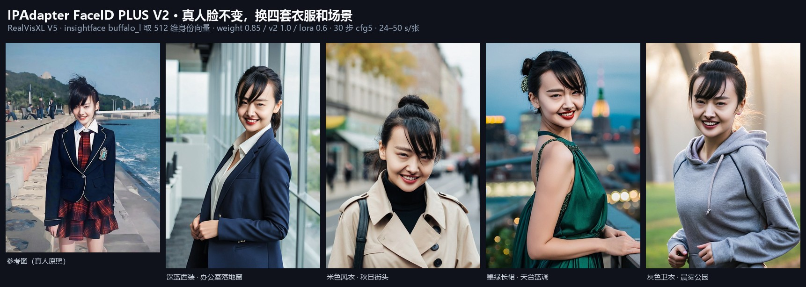
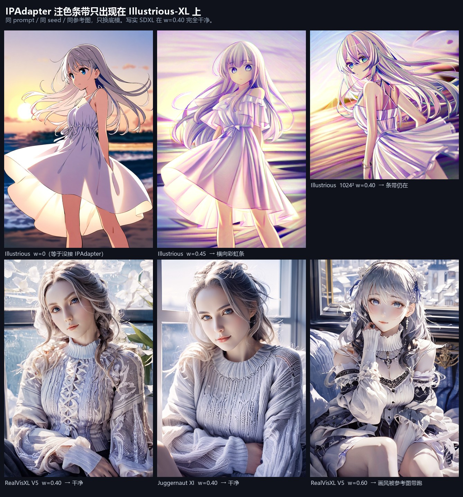

# IPAdapter / FaceID：锁住同一个人

> 目标：换衣服、换场景、换姿势，脸不变。

**返回** [README](../README.md) · [English](../README.en.md) · [变更日志](../CHANGELOG.md) · [底模对比](MODELS.md)



---

## 一、装了什么

| 组件 | 位置 | 体积 |
|---|---|---|
| ComfyUI_IPAdapter_plus | `custom_nodes/ComfyUI_IPAdapter_plus` | 935 KB |
| ip-adapter-plus_sdxl_vit-h | `models/ipadapter/` | 847,517,512 B |
| ip-adapter-plus-face_sdxl_vit-h | `models/ipadapter/` | 847,517,512 B |
| ip-adapter-faceid-plusv2_sdxl.bin | `models/ipadapter/` | 1,487,555,181 B |
| ip-adapter-faceid-plusv2_sdxl_lora.safetensors | `models/loras/` | 371,842,896 B |
| CLIP-ViT-H-14-laion2B-s32B-b79K | `models/clip_vision/` | 2,528,373,448 B |
| insightface buffalo_l（5 个 onnx） | `models/insightface/models/buffalo_l/` | 343,548,726 B |

Python 依赖：`insightface 2.1`、`onnxruntime 1.32.0`、`opencv-python 5.0.0.93`、`scikit-image 0.26.0`、`onnx 1.23.2`。

```powershell
git clone --depth 1 https://github.com/cubiq/ComfyUI_IPAdapter_plus.git "$ComfyDir\custom_nodes\ComfyUI_IPAdapter_plus"
& "$Venv\Scripts\python.exe" -m pip install -i https://pypi.tuna.tsinghua.edu.cn/simple insightface onnxruntime
```

buffalo_l 不在 pip 包里，要单独下：

```bash
bash scripts/fetch_parts.sh "https://github.com/deepinsight/insightface/releases/download/v0.7/buffalo_l.zip" \
  dl/buffalo_l.zip 288621354 8 504b0304
# 解压到 ComfyUI-0.45.0/models/insightface/models/buffalo_l/（注意多一层 models）
```

---

## 二、两种 IPAdapter，别选错

### PLUS（整图特征）

`IPAdapterUnifiedLoader` preset=`PLUS (high strength)` → `IPAdapterAdvanced`。

把参考图整张过 CLIP-Vision，得到 patch 序列灌进 cross-attention。**发色、衣服、背景、光线、色调全部一起进来**，所以换装时衣服会跟参考图打架，换背景时背景色会渗到人物身上。

在 **Illustrious-XL 上会出横向彩虹条**（见下图）——那不是参数没调对，是 anime 精调模型把 UNet cross-attn 的权重改得跟 SDXL base 差太远，PLUS 的 patch 注入进去就成了纹理噪声。RealVisXL / Juggernaut 上同样参数完全干净。



### FaceID PLUS V2（只带脸）

`IPAdapterUnifiedLoaderFaceID` preset=`FACEID PLUS V2` → `IPAdapterFaceID`。

先用 insightface 检测人脸、算一个 512 维身份向量，只把这一个向量送进去，再叠一个专门训的 LoRA（`lora_strength` 0.6）。**完全不碰参考图的配色和衣服**，所以：

- 换装不会跟衣服打架
- 背景色调不会渗
- 任何底模上都不出条带
- 代价是纯换装好用，纯改画风不好用（它不看画风）

**结论：保脸换装一律走 FaceID PLUS V2；要"参考这张图的画风/构图"才用 PLUS。**

---

## 三、参数

| 参数 | 甜点 | 说明 |
|---|---|---|
| `weight` | **0.85** | FaceID 下 0.8–0.9 脸最稳；1.0 开始五官会僵 |
| `weight_faceidv2` | **1.0** | 只在 PLUS V2 生效，调脸的五官还原度 |
| `lora_strength` | **0.6** | 作者默认；>0.8 皮肤会变塑料 |
| `weight_type` | `linear` | 其它档位在 FaceID 下差异很小 |
| `embeds_scaling` | `V only` | FaceID 用 V only；PLUS 才需要 `K+V w/ C penalty` |
| `provider` | **CPU** | 8 GB 卡上别用 CUDA，onnxruntime 抢显存会把 SDXL 挤到 dynamic loading |
| `steps` / `cfg` | 30 / 5 | 跟写实底模基线一致 |
| `denoise` | 1.0 | 换装是重绘，不是图生图 |

PLUS 的参数（如果非要用）：`weight 0.35–0.45` + `linear` + `K+V w/ C penalty` + `PrepImageForClipVision(crop="pad")`。weight ≥ 0.55 会把 patch 特征当纹理糊进画面。

---

## 四、实测

环境：RTX 5060 Laptop 8 GB，`--cache-lru 8 --reserve-vram 0.3`，832×1216，30 步 cfg 5。

### 真人参考（insightface det_score 0.896）

| 场景 | 耗时 | 脸 | 说明 |
|---|---|---|---|
| 深蓝西装 / 办公室落地窗 | 49.6 s | 稳 | 首图含加载 |
| 米色风衣 / 秋日街头 | 27.0 s | 稳 | |
| 墨绿长裙 / 天台蓝调 | 24.1 s | 稳 | |
| 灰色卫衣 / 晨雾公园 | 27.0 s | 稳 | 侧身跑姿也稳 |

四张脸型、眼距、鼻梁、笑起来的牙齿形状全部一致；发色跟参考图（黑发）一致，没被 prompt 里的银发带跑——说明身份向量的权重压过了文本。手部在长裙那张（扶栏杆）没有畸变。

### 动漫参考（`ref_original.jpg`，银发蓝眼）

FaceID 同样能锁住，但产出的脸会往写实方向走——因为身份向量只给五官几何，皮肤质感由底模决定。

### 速度代价

比不加 IPAdapter 慢 **0–10 s**（热态 24–27 s vs 基线 24–30 s）。insightface 走 CPU 检测，每张 0.3–0.5 s，可忽略。

---

## 五、DSH 工作流

已注册三条，都吃 `[1 image] + [size]`：

| 名字 | 底模 | 说明 |
|---|---|---|
| `RealVisXL-V5-FaceID` | RealVisXL_V5.0_fp16 | 纪实/生活档，默认 |
| `Juggernaut-XI-FaceID` | Juggernaut-XI-v11_fp16 | 商业/电影档 |
| `Juggernaut-XI-FaceID-HiRes` | Juggernaut-XI-v11_fp16 | 同上 + 1.5× 二次采样，1248×1824 |

用 `edit_image` 时显式指定：

```
edit_image({
  prompt: "RAW photo, portrait of a young woman, wearing a beige linen blazer ...",
  source_path: "ComfyUI-0.45.0/input/REF.png",
  workflow: "RealVisXL-V5-FaceID",
  size: "832x1216"
})
```

注意 `{{image}}` 只接 1 张；传 2 张会报
`ComfyUI workflow has 1 {{image}} image input(s) but this call has 2 source image(s)`。

这些工作流都吃 `{{width}}` / `{{height}}`，`size` 参数有效。但胶囊里的选择优先于
`workflow:` 参数（见仓库根目录 README 的「胶囊选什么，就一定出什么」一节），
想换工作流要在输入栏胶囊里改。

---

## 六、踩过的坑

1. **hf-mirror 的 Content-Length 不能取第一行。** `curl -sIL | grep content-length | tail -1` 拿到的是 302 跳转前那个假值（902,584,688），真实值在最后一个 200 上（847,517,512）。按假值下会每段都短 57 MB，`SIZE_MISMATCH` 重试 20 次也不会好。正确写法：
   ```bash
   curl -sIL "$URL" | grep -iE "^(HTTP|content-length)" | tail -4
   ```

2. **`.bin` 不是 safetensors。** `ip-adapter-faceid-plusv2_sdxl.bin` 魔数是 `50 4b 03 04`（ZIP，torch 的 pickle 格式），不是 `7b 22 74`（`{"t`）。用 safetensors 的魔数去校验会误判成下载失败。

3. **`models/insightface` 底下还有一层 `models`。** `insightface_loader` 里是
   `FaceAnalysis(name='buffalo_l', root=<ComfyUI>/models/insightface)`，insightface 自己再拼 `/models/<name>`。放错层会报 `FileNotFoundError: .../buffalo_l/det_10g.onnx`。

4. **onnxruntime 没有 CUDA provider。** 这台机器装的是 CPU 版，`providers=['CUDAExecutionProvider']` 会 warning 然后静默回落到 CPU。要用 CUDA 得装 `onnxruntime-gpu`，但 8 GB 卡不建议——光检测就吃掉几百 MB。

5. **`IPAdapterUnifiedLoaderFaceID` 的 preset 名字带空格和括号**，字符串必须完全一致：`FACEID PLUS V2`、`FACEID`、`FACEID PORTRAIT (style transfer)`、`FACEID PORTRAIT UNNORM - SDXL only (strong)`。

---

## 七、已知边界

- **多个人的参考图**：insightface 只取检测分值最高的那张脸，人脸多的图会把主角认错。
- **侧脸 / 大角度**：det_score < 0.4 时身份向量质量会掉，脸开始飘。正面或 3/4 侧最稳。
- **大幅改变年龄**：身份向量里有年龄成分，写 `child` / `elderly` 会让五官回到参考图的年龄。
- **全身远景**：脸只占几十像素时 FaceID 基本失效，跟没用一样。
- **Illustrious-XL 上别用 PLUS**，用 FaceID。
